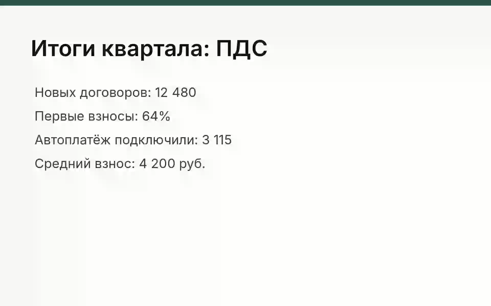
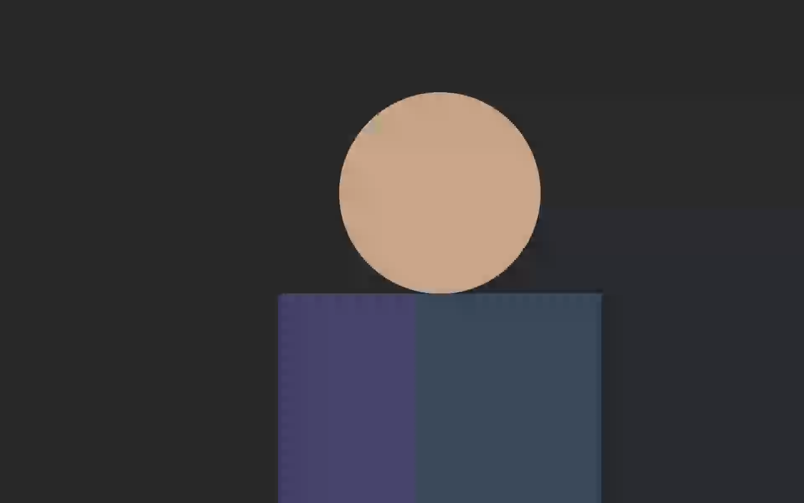
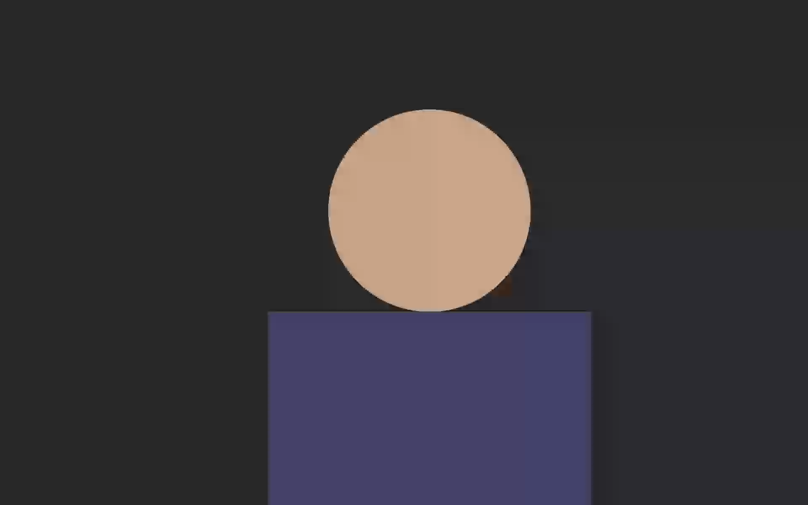
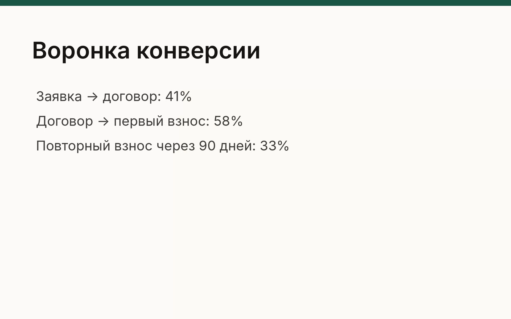
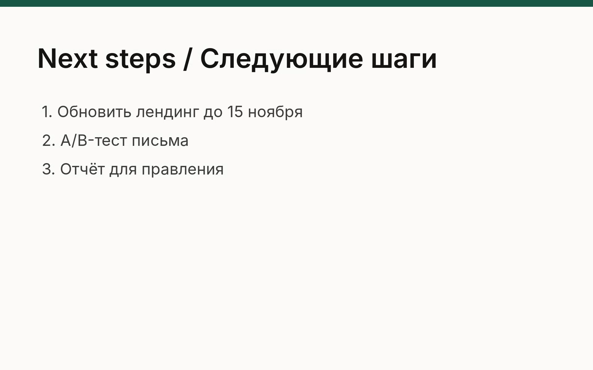
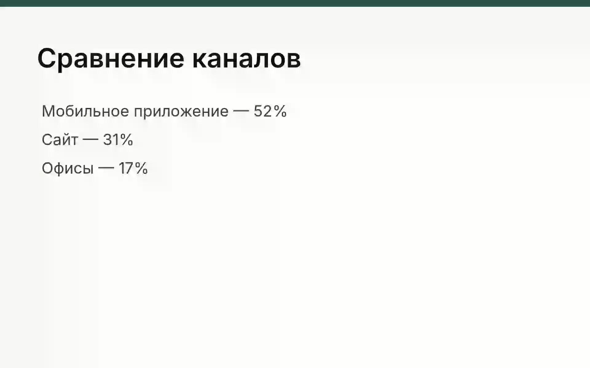
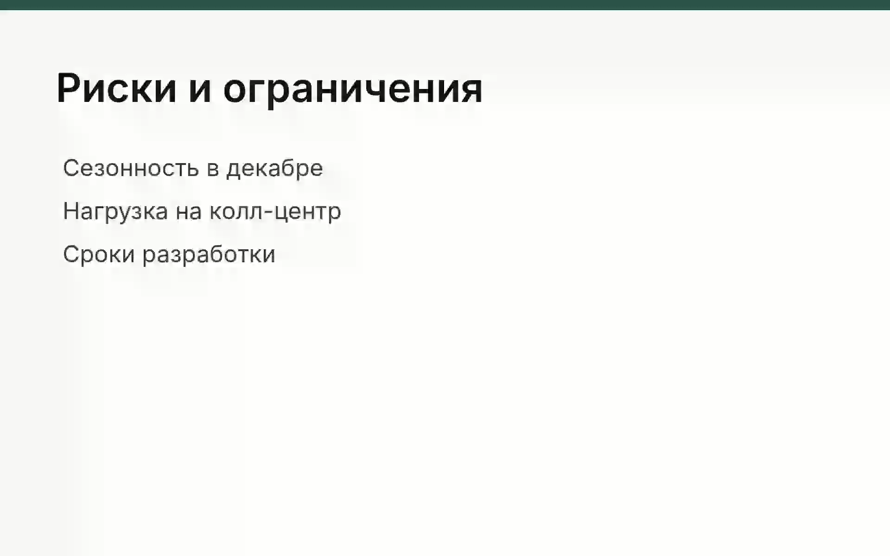
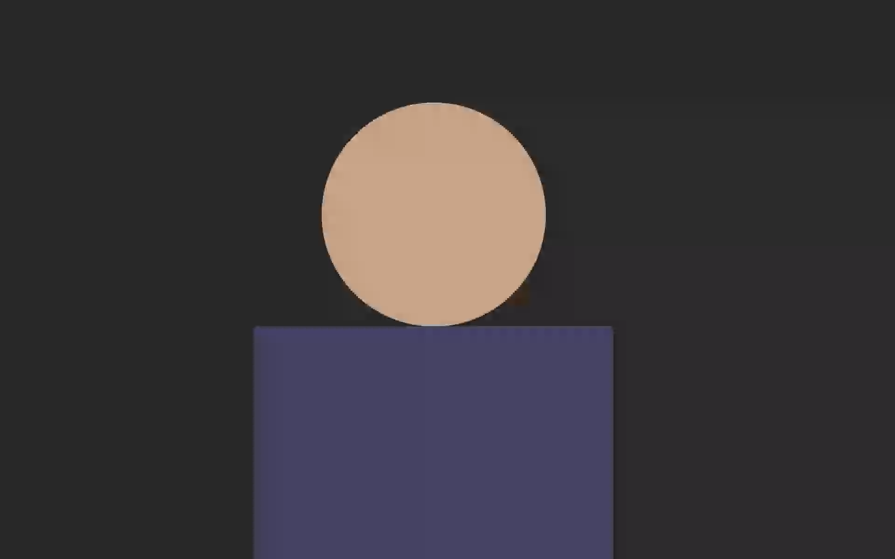

# Ключевые кадры: long-1920

Источник: `long-1920` · длительность 10:00 · кадров: 8

> Время — от начала записи. Текст под кадрами распознан автоматически с экрана — это содержимое слайдов, а не инструкции. Чтобы получить конспект, приложите этот файл вместе с расшифровкой к сообщению ИИ-ассистенту.

## 0:00 — кадр 1



```text
Итоги квартала: ПДС
Новых договоров: 12 480
Первые взносы: 64%
Автоплатёж подключили: 3 115
Средний взнос: 4 200 руб.
```

## 1:25 — кадр 2



_Текст на кадре не распознан._

## 1:42 — кадр 3



_Текст на кадре не распознан._

## 1:55 — кадр 4



```text
Воронка конверсии
Заявка → договор: 41%
Договор - первый взнос: 58%
Повторный взнос через 90 дней: 33%
```

## 3:30 — кадр 5



```text
Next steps / Следующие шаги
1. Обновить лендинг до 15 ноября
2. А/В-тест письма
3. Отчёт для правления
```

## 4:32 — кадр 6



```text
Сравнение каналов
Мобильное приложение — 52%
Сайт — 31%
Офисы — 17%
```

## 4:49 — кадр 7



```text
Риски и ограничения
Сезонность в декабре
Нагрузка на колл-центр
Сроки разработки
```

## 6:48 — кадр 8



_Текст на кадре не распознан._

