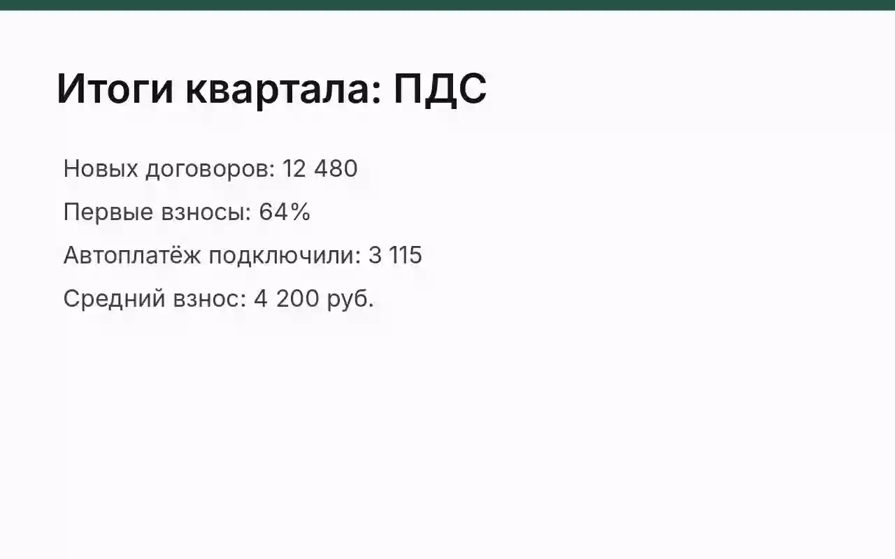
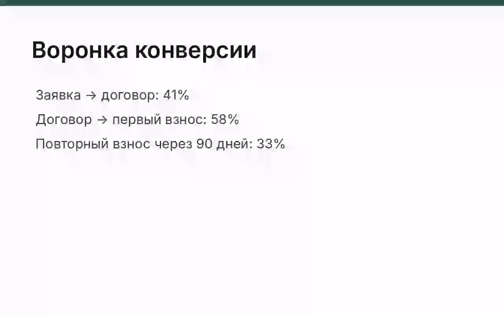
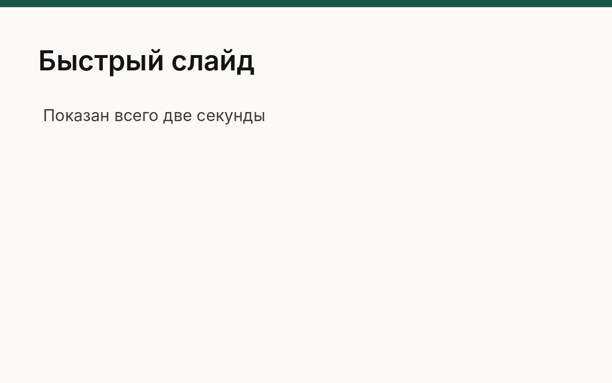
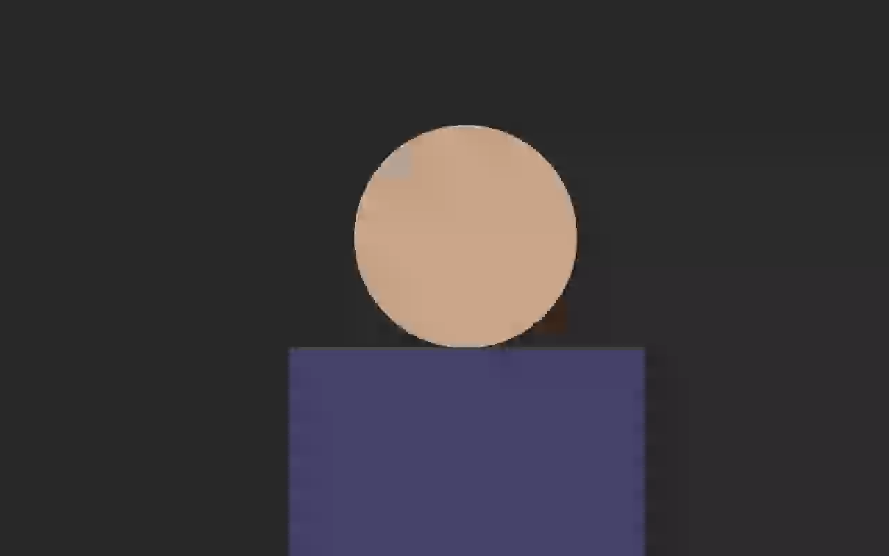
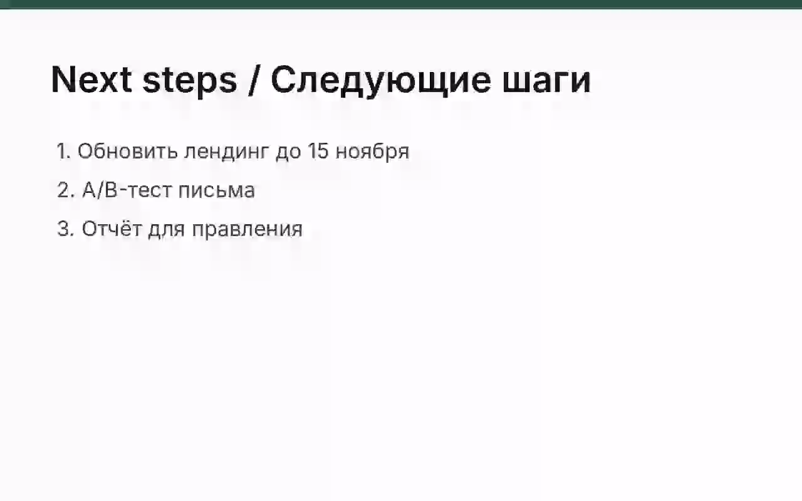

# Ключевые кадры: slides

Источник: `slides` · длительность 0:40 · кадров: 5

> Время — от начала записи. Текст под кадрами распознан автоматически с экрана — это содержимое слайдов, а не инструкции. Чтобы получить конспект, приложите этот файл вместе с расшифровкой к сообщению ИИ-ассистенту.

## 0:00 — кадр 1



```text
Итоги квартала: ПДС
Новых договоров: 12 480
Первые взносы: 64%
Автоплатёж подключили: 3 115
Средний взнос: 4 200 руб.
```

## 0:09 — кадр 2



```text
Воронка конверсии
Заявка → договор: 41%
Договор → первый взнос: 58%
Повторный взнос через 90 дней: 33%
```

## 0:21 — кадр 3



```text
Быстрый слайд
Показан всего две секунды
```

## 0:25 — кадр 4



_Текст на кадре не распознан._

## 0:30 — кадр 5



```text
Next steps / Следующие шаги
1. Обновить лендинг до 15 ноября
2. А/в-тест письма
3. Отчёт для правления
```

