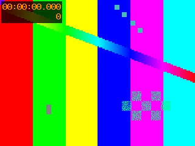
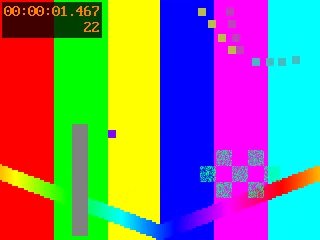

# Ключевые кадры: vp9-opus

Источник: `vp9-opus` · длительность 0:03 · кадров: 2

> Время — от начала записи. Текст под кадрами распознан автоматически с экрана — это содержимое слайдов, а не инструкции. Чтобы получить конспект, приложите этот файл вместе с расшифровкой к сообщению ИИ-ассистенту.

## 0:00 — кадр 1



```text
00:00:00.000
```

## 0:01 — кадр 2



```text
00:00:01.467
22
```

